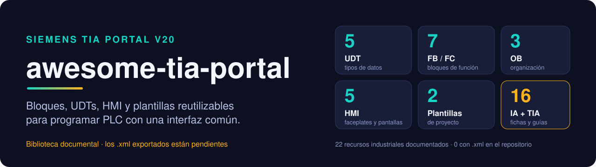
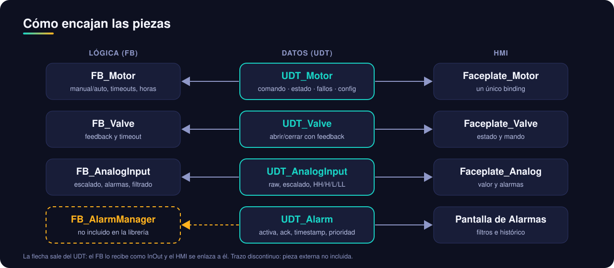
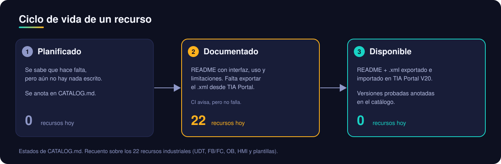

<div align="center">



<br>

[](./LICENSE)


[](./CONTRIBUTING.md)
[](https://github.com/iagorobo24-hub/awesome-tia-portal/actions/workflows/check-resources.yml)
[](https://github.com/iagorobo24-hub/awesome-tia-portal/actions/workflows/estilo.yml)
[](https://github.com/iagorobo24-hub/awesome-tia-portal/actions/workflows/enlaces-externos.yml)

**Biblioteca "awesome" de piezas reutilizables para Siemens TIA Portal V20:**
UDTs, bloques de función, OB, faceplates HMI y plantillas de proyecto que comparten una misma interfaz de datos.
Solo piezas sueltas, no proyectos completos. Pensada para programadores de PLC que quieren estandarizar su código.

[Cómo encaja todo](#cómo-encajan-las-piezas) ·
[Estado](#estado-del-proyecto) ·
[Índice](#índice-de-recursos) ·
[Cómo usar un recurso](#cómo-usar-un-recurso) ·
[Contribuir](#contribuir) ·
[Límites](#límites-conocidos)

</div>

> **Estado del repositorio:** estamos convirtiendo un catálogo de ideas en recursos comprobables. La mayoría de las fichas actuales son diseños documentados; **no contienen todavía un bloque importable**. Cada recurso indica exactamente qué archivo existe y qué prueba se ha realizado.

## Qué ofrece

| | |
|---|---|
| 🏷 **UDTs** | Estructuras estándar (motor, válvula, entrada analógica, variador, alarma) organizadas, en general, en comando, estado, fallos, diagnóstico y configuración. |
| 🧩 **FB / FC** | Bloques que consumen esos UDTs: control de motor y válvula, procesado analógico, escalado, contador de horas, de flancos y generador de pulsos. |
| 🏗 **OB** | Esqueletos de OB1, arranque (OB100) y gestión básica de errores de hardware (OB82/85/86). |
| 🖥 **HMI** | Faceplates enlazados a los UDTs, pantalla de alarmas y plantilla de navegación. |
| 📋 **Plantillas de proyecto** | Estructura mínima de máquina simple y de línea modular. |
| ✂️ **Snippets SCL** | Patrones pequeños (flancos, filtros, saturación) para copiar en tus bloques. |
| 🤖 **IA + TIA Portal** | Guías, comparativas y fichas de herramientas de terceros que conectan modelos de IA con TIA Portal mediante Openness/MCP. No son bloques importables. |

Cada recurso vive en su carpeta con un `README.md` que explica el problema que resuelve, su interfaz, un ejemplo de uso y sus limitaciones.

## Cómo encajan las piezas

La idea de la librería es que el **UDT sea el contrato**: el bloque de función lo recibe como parámetro `InOut` y el HMI se enlaza a él con un único *binding*, en lugar de a decenas de variables sueltas.



Las dependencias salen del campo "Depende de" de cada README. `Pantalla de Alarmas` y `UDT_Alarm` necesitan un gestor de alarmas (`FB_AlarmManager`) que **no forma parte** de la librería.

## Estado del proyecto

Un resumen honesto de lo que hay.

| Pieza | Estado | Nota |
|---|:---:|---|
| 5 UDTs, 8 FB/FC, 3 OB, 5 HMI y 2 plantillas | 🟡 | Documentados (README con interfaz, uso y limitaciones). **Un recurso (`FB_AlarmLatch` 🔧) incluye además fuente SCL compilada en V20 con evidencia; sigue sin haber ningún `.xml` publicado**. |
| Importación y compilación en TIA Portal V20 | 🚧 | No demostradas en general. Excepción: `FB_AlarmLatch` se compiló como fuente SCL en V20 (CPU S7-1500 de demostración, 0 errores y 0 advertencias). Importación desde `.xml` y prueba en PLCSIM, pendientes. Los README indican compatibilidad con V18/V19 como anotación de la autoría, sin verificar. |
| Validación de estructura (`scripts/validate-resources.sh`) | ✅ | Comprueba que cada recurso tiene `README.md` y avisa si falta el `.xml`. No analiza SCL, XML ni compatibilidad. |
| Ejemplos SCL dentro de los README | 🟡 | Son ilustrativos: no se han compilado ni probado en un PLC ni en PLCSIM. |
| Fichas y guías de IA + TIA Portal | 🟡 | Texto de consulta. Cifras, estrellas, precios y compatibilidades de herramientas de terceros no están verificadas y pueden haber cambiado. |

✅ comprobado · 🟡 documentado, pendiente de validar · 🚧 por hacer.



> El estado de cada recurso se mantiene en [`CATALOG.md`](./CATALOG.md): ✅ disponible (README + `.xml`), 📝 solo documentado, ⏳ planificado.

## Índice de recursos

Todos están hoy en estado 📝 (documentados). La tabla completa, con versión y familia de PLC, está en el [catálogo](./CATALOG.md).

<details open>
<summary><b>🏷 Tipos de datos (UDT)</b></summary>

Carpeta: [`tipos-de-datos/`](./tipos-de-datos/)

| Recurso | Qué es |
|---|---|
| [`UDT_Motor`](./tipos-de-datos/udt-motor/) | Control y diagnóstico de motor digital (comando, estado, fallos, diagnóstico, configuración). |
| [`UDT_AnalogInput`](./tipos-de-datos/udt-analog-input/) | Entrada analógica con raw, escalado, alarmas HH/H/L/LL, calidad y unidades. |
| [`UDT_Valve`](./tipos-de-datos/udt-valve/) | Válvula digital (abrir/cerrar) con feedback y timeout. |
| [`UDT_Drive`](./tipos-de-datos/udt-drive/) | Variador de frecuencia: consigna, realimentación y fallos típicos. |
| [`UDT_Alarm`](./tipos-de-datos/udt-alarm/) | Alarma con activación, reconocimiento, marca de tiempo y prioridad. |

</details>

<details open>
<summary><b>🧩 Bloques de función (FB / FC)</b></summary>

Carpeta: [`bloques-de-funcion/`](./bloques-de-funcion/)

| Recurso | Qué es |
|---|---|
| [`FC_Escalado`](./bloques-de-funcion/fc-escalado/) | Escalado lineal INT (0-27648) a REAL en unidades de ingeniería. |
| [`FB_Motor`](./bloques-de-funcion/fb-motor/) | Control de motor: manual/auto, vigilancia de feedback con timeout, horas y arranques. Usa `UDT_Motor`. |
| [`FB_AnalogInput`](./bloques-de-funcion/fb-analog-input/) | Procesado de entrada analógica: escalado, alarmas, filtrado y simulación. Usa `UDT_AnalogInput`. |
| [`FB_Valve`](./bloques-de-funcion/fb-valve/) | Control de válvula con feedback y timeout. Usa `UDT_Valve`. |
| [`FB_Hourmeter`](./bloques-de-funcion/fb-hourmeter/) | Contador de horas con persistencia. |
| [`FB_EdgeCounter`](./bloques-de-funcion/fb-edge-counter/) | Contador de flancos con reset. |
| [`FB_PulseGen`](./bloques-de-funcion/fb-pulse-gen/) | Generador de pulsos parametrizable (Hz o periodo). |
| [`FB_AlarmLatch`](./bloques-de-funcion/fb-alarm-latch/) 🔧 | Enclavamiento de alarma con reconocimiento; fuente SCL compilada en V20 (0 errores, 0 advertencias, evidencia en su ficha), PLCSIM pendiente. |

</details>

<details>
<summary><b>🏗 Bloques de organización (OB)</b></summary>

Carpeta: [`bloques-de-organizacion/`](./bloques-de-organizacion/)

| Recurso | Qué es |
|---|---|
| [`OB1 — Plantilla`](./bloques-de-organizacion/ob1-plantilla/) | OB1 con secciones: lectura, seguridad, lógica, diagnóstico y escritura. |
| [`OB100 — Startup`](./bloques-de-organizacion/ob100-startup/) | Arranque con inicialización típica. |
| [`OB82 / OB85 / OB86`](./bloques-de-organizacion/ob82-85-86-errores/) | Gestión básica de errores de hardware (esqueletos). |

</details>

<details>
<summary><b>🖥 HMI</b></summary>

Carpeta: [`hmi/`](./hmi/)

| Recurso | Qué es |
|---|---|
| [`Faceplate_Motor`](./hmi/faceplate-motor/) | Faceplate enlazado a `UDT_Motor`. |
| [`Faceplate_Valve`](./hmi/faceplate-valve/) | Faceplate enlazado a `UDT_Valve`. |
| [`Faceplate_Analog`](./hmi/faceplate-analog/) | Faceplate enlazado a `UDT_AnalogInput`, con alarmas. |
| [`Pantalla de Alarmas`](./hmi/pantalla-alarmas/) | Pantalla base de alarmas con filtros y reconocimiento. |
| [`Plantilla de Navegación`](./hmi/plantilla-navegacion/) | Cabecera, pie y área de contenido reutilizables. |

</details>

<details>
<summary><b>📋 Plantillas de proyecto</b></summary>

Carpeta: [`plantillas-de-proyecto/`](./plantillas-de-proyecto/)

| Recurso | Qué es |
|---|---|
| [`plantilla-maquina-simple`](./plantillas-de-proyecto/plantilla-maquina-simple/) | 1 PLC + 1 HMI Basic, estructura mínima. |
| [`plantilla-linea-modular`](./plantillas-de-proyecto/plantilla-linea-modular/) | Varios PLC comunicados con librerías compartidas. |

</details>

<details>
<summary><b>🤖 IA + TIA Portal</b></summary>

Carpeta: [`ia-tia-portal/`](./ia-tia-portal/). Material de consulta, no bloques importables. Empieza por la [guía general](./ia-tia-portal/README.md).

| Tema | Enlaces |
|---|---|
| Herramientas de terceros (fichas) | [`tia-portal-mcp-server`](./ia-tia-portal/tia-portal-mcp-server/) · [`t-ia-connect`](./ia-tia-portal/t-ia-connect/) · [`totally-integrated-claude`](./ia-tia-portal/totally-integrated-claude/) · [`tia-portal-openness-mcpserver`](./ia-tia-portal/tia-portal-openness-mcpserver/) · [`tia-openness-agent-platform`](./ia-tia-portal/tia-openness-agent-platform/) |
| Aprender | [`guía de conexión profesional V20`](./ia-tia-portal/guias/conexion-profesional-v20.md) · [`tutoriales`](./ia-tia-portal/tutoriales/) · [`prompts`](./ia-tia-portal/prompts/) · [`roadmap`](./ia-tia-portal/roadmap/) · [`best-practices`](./ia-tia-portal/best-practices/) |
| Referencia | [`comparativas`](./ia-tia-portal/comparativas/) · [`integraciones`](./ia-tia-portal/integraciones/) · [`plantillas`](./ia-tia-portal/plantillas/) · [`troubleshooting`](./ia-tia-portal/troubleshooting/) · [`galeria`](./ia-tia-portal/galeria/) · [`casos-de-uso`](./ia-tia-portal/casos-de-uso/) · [`entorno-cloud`](./ia-tia-portal/entorno-cloud/) |

Las herramientas de terceros pertenecen a sus autores; consulta su repositorio para el estado, la licencia y la compatibilidad actuales. Los ejemplos y las cifras de estos documentos no están verificados de forma independiente.

</details>

## Cómo usar un recurso

1. **Elige** el recurso en el [índice](#índice-de-recursos) y lee su `README.md`: interfaz, ejemplo y limitaciones.
2. **Respeta las dependencias**: por ejemplo, `FB_Motor` necesita `UDT_Motor` importado antes.
3. **Importa el `.xml`** cuando exista: en TIA Portal, clic derecho en *Bloques de programa* (o *Tipos de datos PLC*) y *Importar*.
4. **Prueba en simulación** (PLCSIM o un equipo de pruebas) antes de acercarlo a una instalación real.

> Hoy el paso 3 aún no es posible para ningún recurso, porque los `.xml` no están publicados. Mientras tanto, los README sirven como especificación de la interfaz y del comportamiento esperado.

¿No sabes por dónde empezar? Sigue una [ruta de aprendizaje](docs/rutas/) según tu nivel, consulta el [glosario ES↔EN](docs/glosario.md) cuando un término se te cruce y las [preguntas frecuentes](docs/faq.md) antes de abrir un issue. Para formarte fuera del repo: [vídeos y formación curada](docs/videos.md).
>
> 🔧 **Recurso con fuente real:** [`FB_AlarmLatch`](./bloques-de-funcion/fb-alarm-latch/) incluye su `.scl`, compilado en V20 con evidencia y capturas del fixture; la prueba de comportamiento en PLCSIM está preparada y pendiente. Para conectar un agente de IA a TIA Portal, empieza por la [guía de conexión profesional V20](./ia-tia-portal/guias/conexion-profesional-v20.md).

## Contribuir

Una aportación es una carpeta con su `README.md` y, cuando esté exportado, el `.xml`.

- Pasos detallados, pensados para quien viene del mundo PLC: [`CONTRIBUTING.md`](./CONTRIBUTING.md).
- Convenciones de nombres, prefijos, README y compatibilidad: [`STYLE.md`](./STYLE.md).
- Plantilla del README de cada recurso: [`_plantillas/README-recurso.md`](./_plantillas/README-recurso.md).
- Al subir un recurso, actualiza su fila en [`CATALOG.md`](./CATALOG.md) con el estado y las versiones realmente probadas.
- Si prefieres no usar Git, abre un [issue](https://github.com/iagorobo24-hub/awesome-tia-portal/issues/new/choose) con tu propuesta.

Convención de carpetas: una carpeta en minúsculas con guiones por recurso (`udt-motor/`, `fb-analog-input/`); dentro de TIA Portal, nombres con prefijo (`UDT_`, `FB_`, `FC_`, `Faceplate_`, `Pantalla_`).

## Límites conocidos

- **Sin artefactos importables todavía**: cero `.xml` en el repositorio. No hay evidencia de que los bloques se importen ni compilen en V20.
- Los **ejemplos SCL** de los README son ilustrativos y no se han ejecutado; revisa casos límite (parada, fallo, reset, rangos nulos) antes de copiarlos.
- Algunas piezas tienen **dependencias o requisitos sin resolver**: `UDT_Alarm` y `Pantalla de Alarmas` necesitan un gestor de alarmas que no se incluye; `plantilla-maquina-simple` indica un panel Basic mientras otros faceplates declaran limitaciones en Basic.
- Las **plantillas de proyecto** hablan de un archivo de proyecto comprimido, pero el repositorio excluye archivos de proyecto completos (`.gitignore`).
- La validación automática (`scripts/validate-resources.sh`, ejecutada por el workflow de GitHub Actions en los pull requests) solo comprueba la existencia de README y XML.
- La compatibilidad con otras versiones (V18/V19) y con S7-1200 frente a S7-1500 está anotada por la autoría y **no verificada**.
- Esto es material de apoyo, no un sistema certificado: validar cualquier bloque antes de usarlo en una instalación es responsabilidad de quien lo usa.

## Estructura del proyecto

```

tipos-de-datos/            UDTs (una carpeta por recurso, con README.md)
bloques-de-funcion/        FB y FC (fb-alarm-latch incluye fuente SCL + evidencia)
bloques-de-organizacion/   OB
hmi/                       faceplates, pantallas y plantilla de navegación
plantillas-de-proyecto/    estructuras base de proyecto
snippets/                  patrones SCL pequeños reutilizables
ia-tia-portal/             guías (incluye conexión profesional V20) y fichas de IA + TIA Portal
_plantillas/               plantilla de README y de tabla VAT para nuevos recursos
assets/                    ilustración de portada (generada, no es captura de TIA)
scripts/                   validación, catálogo auto-generado y revisión de enlaces
.github/                   workflow de validación y plantillas de issues/PR
docs/                      gráficos, rutas de aprendizaje, glosario, FAQ, vídeos, hoja de ruta y referencias
CATALOG.md                 índice y estado de cada recurso
CONTRIBUTING.md  STYLE.md  guía de contribución y de estilo
```

## Licencia

[MIT](./LICENSE). Las herramientas de terceros descritas en `ia-tia-portal/` tienen sus propias licencias.

---

<div align="center">

<sub>Proyecto personal de la comunidad, no afiliado a Siemens. Siemens, SIMATIC y TIA Portal son marcas de sus propietarios.</sub>

</div>
