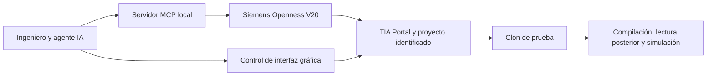

# Awesome TIA Portal

  

**Recursos seleccionados para diseñar, programar, documentar y probar proyectos Siemens TIA Portal.** Bloques, guías de ingeniería, herramientas para agentes de IA y plantillas explicadas para que puedas juzgar cuándo te sirven.

> **Estado del repositorio:** estamos convirtiendo un catálogo de ideas en recursos comprobables. La mayoría de las fichas actuales son diseños documentados; **no contienen todavía un bloque importable**. Cada recurso indica exactamente qué archivo existe y qué prueba se ha realizado.

Contenido en español. *A curated, evidence-led collection for TIA Portal engineers; English contributions and translations are welcome.*

## Empieza aquí

| Si buscas… | Ve a… | Qué encontrarás hoy |
|---|---|---|
| Un bloque con código fuente | [FB_AlarmLatch](bloques-de-funcion/fb-alarm-latch/) | Fuente SCL y ejemplo de uso; compilación V20 registrada, comportamiento en PLCSIM pendiente. |
| Conectar un agente de IA a TIA | [Guía de conexión profesional V20](ia-tia-portal/guias/conexion-profesional-v20.md) | Openness, MCP, interfaz gráfica y una secuencia segura de comprobación. |
| Explorar herramientas de IA | [IA + TIA Portal](ia-tia-portal/) | Puertas de entrada a herramientas y tutoriales; comprobar versión y alcance de cada una. |
| Buscar una idea de bloque | [Catálogo](CATALOG.md) | Fichas documentadas, recursos con fuente y trabajo previsto, separados por estado. |
| Compartir tu solución | [Guía de contribución](CONTRIBUTING.md) | Qué adjuntar, cómo indicar evidencia y cómo abrir una propuesta. |

## Explora la colección

| Área | Contenido |
|---|---|
| [FB y FC](bloques-de-funcion/) | Lógica de control, diagnóstico y tratamiento de señales. |
| [UDT](tipos-de-datos/) | Contratos de datos para PLC y HMI. |
| [OB](bloques-de-organizacion/) | Patrones de organización y diagnóstico. |
| [HMI](hmi/) | Faceplates y pantallas, con la familia Runtime indicada por recurso. |
| [Plantillas de proyecto](plantillas-de-proyecto/) | Estructuras de partida y decisiones de diseño. |
| [IA + TIA Portal](ia-tia-portal/) | APIs, servidores MCP, flujos de trabajo y límites verificados. |

## Cómo leer el estado de un recurso

| Estado | Significado |
|---|---|
| **Idea / documentación** | Hay explicación o interfaz propuesta, pero no hay archivo de bloque utilizable. |
| **Fuente disponible** | Hay `.scl` u otro archivo fuente descargable; no implica XML importable ni prueba en runtime. |
| **Compilado** | Se ha compilado en una versión y configuración declaradas, con evidencia; todavía puede faltar PLCSIM o HMI Runtime. |
| **Probado en simulación** | Una prueba de comportamiento observable y sus condiciones están documentadas. |

La versión de TIA, el tipo de CPU/HMI, las dependencias y los límites van en cada ficha. Ninguna etiqueta sustituye la revisión de seguridad o la validación en tu instalación.

## IA y TIA Portal, en una imagen

MCP y una aplicación .NET directa usan la **misma API Openness**. El control gráfico permite ver editores y diálogos; su disponibilidad depende de la sesión. La [guía V20](ia-tia-portal/guias/conexion-profesional-v20.md) explica qué se ha comprobado y qué queda pendiente.

## Contribuye

Buscamos recursos pequeños, claros y reproducibles: una necesidad concreta, código o archivo cuando exista, ejemplo de uso, versión probada y límites. Se aceptan también correcciones de documentación y casos de prueba. Lee [CONTRIBUTING.md](CONTRIBUTING.md) antes de proponer un recurso; si solo tienes la idea, [abre una issue](https://github.com/iagorobo24-hub/awesome-tia-portal/issues/new).

La selección editorial se inspira en el [manifiesto Awesome](https://github.com/sindresorhus/awesome/blob/main/awesome.md): **curar antes que acumular**. [Estas referencias](docs/referencias-awesome.md) explican las decisiones de estructura del repositorio.

La [hoja de ruta](docs/hoja-de-ruta.md) muestra las próximas pruebas, capturas y recursos previstos.

## Licencia y material visual

El código y la documentación propios se publican bajo [MIT](LICENSE). La imagen de portada es una **ilustración generada**, no una captura de TIA ni una prueba de funcionamiento. Las futuras capturas de TIA deberán proceder de proyectos de demostración sin datos de cliente y llevar versión, fecha y contexto de la prueba.
