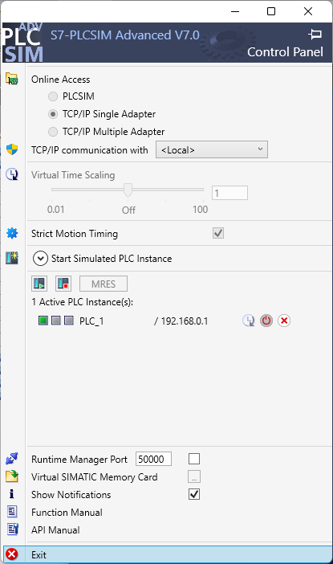

# FB_AlarmLatch

> Enclavamiento de alarma con reconocimiento y petición de sirena; fuente SCL compilada en V20, PLCSIM pendiente.

Enclava una alarma de proceso, conserva una alarma que ya desapareció sin reconocimiento y genera una petición de sirena hasta que el operador la reconozca.

**Archivo:** [FB_AlarmLatch.scl](FB_AlarmLatch.scl) · **Lenguaje:** SCL · **Versión de bloque:** 0.1 · **Dependencias:** temporizador `TON_TIME` de TIA Portal.

## Estado comprobado

- **Fuente disponible:** el archivo SCL se incluye aquí. Procede de la librería propia MIT de [TIA-Claude](https://github.com/iagorobo24-hub/T-IA-Portal-RocaRoibas/tree/master/60-library/blocks).
- **Compilación de esta copia:** importada en un proyecto desechable con CPU S7-1500 `6ES7513-1AM03-0AB0` y compilada en TIA Portal V20 el 23/09/2026 con **0 errores y 0 advertencias**. Tras guardar, un proceso MCP independiente volvió a abrir el proyecto y leyó `FB_AlarmLatch [FB1, SCL]`. [Evidencia estructurada](evidencia-tia-v20-2026-09-23.json).
- **Arnés OB1 construido y compilado (2026-10-19):** el `Main` en LAD del proyecto desechable se sustituyó por un **OB1 en SCL** que llama al DB de instancia `AlarmPump` con los nueve parámetros cableados a tags globales. El proyecto resultante compila con **0 errores y 0 avisos**, y el árbol final leído en vivo muestra `FB_AlarmLatch [FB2, SCL]`, `AlarmPump [DB1, DB]` y `Main [OB1, SCL]`. El SCL exacto que se ejecutó está en [OB1_Arnes-ejecutado.scl](OB1_Arnes-ejecutado.scl) y el detalle de la secuencia está en el [informe de ejecución](informe-ejecucion-2026-10-19.md). El FB se exportó a SimaticML en [FB_AlarmLatch.xml](FB_AlarmLatch.xml).
- **PLCSIM: descarga y 9 casos verificados (2026-10-21).** `Download Success` (0 errores, 0 avisos) por la ruta `PN/IE / Siemens PLCSIM Virtual Ethernet Adapter`, `GoOnline` → `Online, isReachable=true`, y el plan de **65 pasos pasó 65/65** con las nueve transiciones de comportamiento correctas. Evidencia en [`evidencia-plcsim-2026-10-21.json`](evidencia-plcsim-2026-10-21.json) y detalle por caso en la [matriz de compatibilidad](matriz-compatibilidad.md).
- **Hizo falta cumplir cuatro condiciones a la vez**, ninguna evidente: (1) la sesión Openness va **adjunta** al TIA abierto (`AttachToOpenProject`), no aislada — en sesión headless el mismo proyecto falla aunque la CPU virtual esté viva; (2) **~100 s de margen** tras arrancar el Control Panel de PLCSIM Advanced; (3) `IInstance::UpdateTagList()` antes de leer tags, si no la lectura simbólica devuelve `-47`; (4) los tags se nombran **sin el prefijo de tabla** (`Active`, no `Agent_Signals.Active`), si no devuelven `-4`.
- **Compilación de hardware: había un defecto real y aparte.** `CompileSoftware` solo compila software, y por eso toda la sesión dio 0/0 mientras la configuración de hardware **fallaba con 3 errores** por la protección de datos de configuración de la PLC (el mismo diagnóstico documentado en `R17` el 28/09). Se reproduce y se corrige **sin tocar ninguna contraseña** con dos herramientas acotadas de `tia-inspect --isolated`: el hardware pasa a **0 errores y 0 avisos**. Es el **primer uso live** documentado de `DisableUnconfiguredPlcConfigurationProtection`. El hash del `.ap20` **no** refleja el cambio.
- **Dos bugs del adaptador de PLCSIM, corregidos.** El parser de IP **invertía los octetos**, de modo que la CPU virtual recibía `1.0.168.192` en vez de `192.168.0.1` (el `SetIPSuite` lo aceptaba con `0x0` y lo descartaba en silencio); y el camino de registro **nunca enlazaba el puerto IE1** con la NIC (`SetNetInterfaceMapping`/`SetNetInterfaceBindings` estaban en código muerto). Con ambas correcciones: **`ping` sin pérdidas, ARP resolviendo a la MAC virtual `02-C0-A8-00-02-00` y lectura S7 con `identityConfirmed: true` (`CPU 1513-1 PN`)**. Ver RC-1 a RC-5 en el [informe de ejecución](informe-ejecucion-2026-10-19.md).
- **El simulador, verificado sano (estado del 19/10, ya superado):** la instancia se inspeccionó a fondo: `PLC_1` (`nameCode 0x0`), CPU `1513` (= *1513-1 PN*, la del proyecto), IP `192.168.0.1`, una sola instancia registrada. Del lado de TIA, su configuración PG/PC guardada (`Settings.xml`) apunta al driver `PLCSIM.TCPIP.1`, que **no existe en el registro**; probarlo con otro valor no cambió ni la ruta ni el fallo. Detalle en los hallazgos H-33 a H-36 del [informe de ejecución](informe-ejecucion-2026-10-19.md).
- **Comportamiento en PLCSIM: verificado (2026-10-21).** Los nueve casos del [protocolo](protocolo-plcsim.md) se observaron con valores reales: el plan de 65 pasos pasó **65/65** y las nueve transiciones de comportamiento son correctas. La [evidencia del 2026-10-21](evidencia-plcsim-2026-10-21.json) los recoge con los valores observados, y la [captura del Control Panel](assets/plcsim-control-panel-2026-10-21.png) deja ver la instancia `PLC_1` en marcha. La [evidencia del 2026-10-19](evidencia-plcsim-2026-10-19.json) refleja el estado anterior (compilación verificada, ejecución no) y se conserva como registro de esa tanda.
- **Inspección del 24/09/2026:** TIA V20 abrió el fixture; la ruta PG/PC virtual de Siemens apareció en la comprobación de descarga, junto a una interfaz física. Eso **no acredita una descarga ni una ejecución**. [Registro del preflight](evidencia-preflight-2026-09-24.json).
- **Pendiente:** importación del XML desde cero y matriz de CPU/HSP completa. La descarga y el comportamiento en PLCSIM están verificados desde el 21/10/2026. No se declara listo para producción. Documentos preparados para ejecutar: [arnés OB1](arnes-ob1.md), [protocolo PLCSIM](protocolo-plcsim.md) (+ [plantilla de evidencia](evidencia-plcsim-plantilla.json)) y [exportación XML](exportacion-xml.md).


*Captura directa de TIA Portal V20 sobre el fixture desechable, 24/09/2026. Muestra el código y la interfaz, no una prueba online.*



*Captura directa del Control Panel de PLCSIM Advanced V7.0, 21/10/2026: `1 Active PLC
Instance(s): PLC_1` en marcha y `/ 192.168.0.1`, en modo `TCP/IP Single Adapter`. Es la prueba
de que el destino de la descarga era una CPU virtual.*

## Interfaz

| Señal | Dirección | Significado |
|---|---|---|
| `Condition` | Entrada | Condición de alarma ya evaluada. |
| `CmdAck` | Entrada | Orden de reconocimiento. |
| `Enable` | Entrada | Permite la alarma; `FALSE` borra el enclavamiento. |
| `OnDelay` | Entrada | Tiempo de filtrado; `T#0S` deja paso inmediato. |
| `Active` | Salida | Condición filtrada presente. |
| `Latched` | Salida | Alarma aún visible. |
| `Unacked` | Salida | Pendiente de reconocer. |
| `GoneUnacked` | Salida | Condición desaparecida, sin reconocimiento. |
| `Horn` | Salida | Petición de sirena mientras no se reconozca. |

## Estados esperados

| Condición | Reconocida | Resultado |
|---|---|---|
| Presente | No | Activa, enclavada y sirena solicitada. |
| Presente | Sí | Sigue activa y visible; sirena apagada. |
| Desaparecida | No | Sigue visible como `GoneUnacked`; sirena solicitada. |
| Desaparecida | Sí | Se borra el enclavamiento. |

La tabla describe la intención del código. **Sigue necesitando una prueba de transiciones en PLCSIM**, que no se ha podido ejecutar: la descarga a la CPU virtual quedó bloqueada por el hallazgo H-19 (ver [matriz de compatibilidad](matriz-compatibilidad.md)). El reconocimiento se evalúa como nivel: si `CmdAck` permanece a `TRUE` al aparecer una alarma nueva, esta puede quedar reconocida en ese mismo ciclo. Ese comportamiento está **documentado por diseño**, no observado todavía.

## Uso en un proyecto de prueba

1. Trabaja sobre una copia de un proyecto V20 y conserva un backup antes de importar.
2. Crea una fuente externa SCL desde [FB_AlarmLatch.scl](FB_AlarmLatch.scl) y genera el bloque desde ella en TIA Portal. Comprueba nombre, lenguaje e interfaz en el proyecto resultante.
3. Compila el software PLC. Si hay errores, corrige o revierte; guarda solo después de compilar correctamente.
4. Prueba en una CPU virtual las cuatro transiciones de la tabla antes de utilizarlo en una máquina.

Ejemplo conceptual de llamada desde un bloque que ya declara una instancia `AlarmPump`:

```scl

#AlarmPump(
    Condition := #PumpFault,
    CmdAck := #Acknowledge,
    Enable := TRUE,
    OnDelay := T#500MS,
    Active => #AlarmActive,
    Latched => #AlarmVisible,
    Unacked => #AlarmUnacked,
    GoneUnacked => #AlarmGoneUnacked,
    Horn => #HornRequest
);
```

`Horn` es una **petición de proceso**. Este FB no implementa funciones F/Safety ni sustituye una cadena de seguridad certificada. `Enable := FALSE` borra la memoria; decide explícitamente si esa semántica es adecuada para tu instalación.
