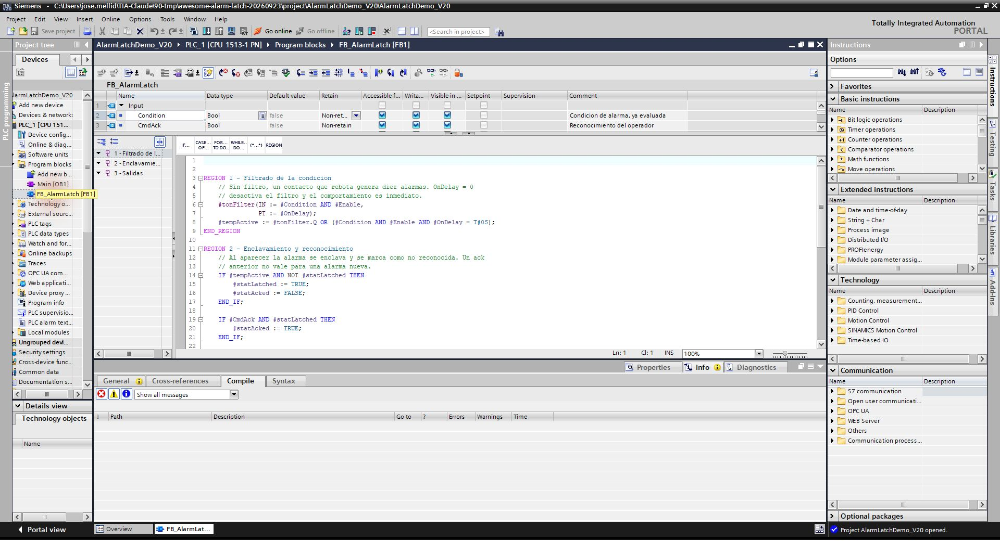

# FB_AlarmLatch

> Enclavamiento de alarma con reconocimiento y petición de sirena; fuente SCL compilada en V20, PLCSIM pendiente.

Enclava una alarma de proceso, conserva una alarma que ya desapareció sin reconocimiento y genera una petición de sirena hasta que el operador la reconozca.

**Archivo:** [FB_AlarmLatch.scl](FB_AlarmLatch.scl) · **Lenguaje:** SCL · **Versión de bloque:** 0.1 · **Dependencias:** temporizador `TON_TIME` de TIA Portal.

## Estado comprobado

- **Fuente disponible:** el archivo SCL se incluye aquí. Procede de la librería propia MIT de [TIA-Claude](https://github.com/iagorobo24-hub/T-IA-Portal-RocaRoibas/tree/master/60-library/blocks).
- **Compilación de esta copia:** importada en un proyecto desechable con CPU S7-1500 `6ES7513-1AM03-0AB0` y compilada en TIA Portal V20 el 23/09/2026 con **0 errores y 0 advertencias**. Tras guardar, un proceso MCP independiente volvió a abrir el proyecto y leyó `FB_AlarmLatch [FB1, SCL]`. [Evidencia estructurada](evidencia-tia-v20-2026-09-23.json).
- **PLCSIM:** se encendió y apagó una CPU 1513 virtual temporal, pero **no se descargó este programa**. La [prueba de transiciones](prueba-plcsim.md) está preparada y pendiente de ejecución.
- **Inspección del 24/09/2026:** TIA V20 abrió el fixture; `Main [OB1, LAD]` tiene un network vacío, sin llamada al FB. La compilación siguió en **0 errores y 0 advertencias**; la ruta PG/PC virtual de Siemens apareció en la comprobación de descarga, junto a una interfaz física. Eso **no acredita una descarga ni una ejecución**. [Registro del preflight](evidencia-preflight-2026-09-24.json).
- **Pendiente:** arnés cíclico y comportamiento en PLCSIM, exportación XML de esta copia y matriz de CPU/HSP. No se declara listo para producción. Documentos preparados para ejecutar: [arnés OB1](arnes-ob1.md), [protocolo PLCSIM](protocolo-plcsim.md) (+ [plantilla de evidencia](evidencia-plcsim-plantilla.json)) y [exportación XML](exportacion-xml.md).



*Captura directa de TIA Portal V20 sobre el fixture desechable, 24/09/2026. Muestra el código y la interfaz, no una prueba online.*

## Interfaz

| Señal | Dirección | Significado |
|---|---|---|
| `Condition` | Entrada | Condición de alarma ya evaluada. |
| `CmdAck` | Entrada | Orden de reconocimiento. |
| `Enable` | Entrada | Permite la alarma; `FALSE` borra el enclavamiento. |
| `OnDelay` | Entrada | Tiempo de filtrado; `T#0S` deja paso inmediato. |
| `Active` | Salida | Condición filtrada presente. |
| `Latched` | Salida | Alarma aún visible. |
| `Unacked` | Salida | Pendiente de reconocer. |
| `GoneUnacked` | Salida | Condición desaparecida, sin reconocimiento. |
| `Horn` | Salida | Petición de sirena mientras no se reconozca. |

## Estados esperados

| Condición | Reconocida | Resultado |
|---|---|---|
| Presente | No | Activa, enclavada y sirena solicitada. |
| Presente | Sí | Sigue activa y visible; sirena apagada. |
| Desaparecida | No | Sigue visible como `GoneUnacked`; sirena solicitada. |
| Desaparecida | Sí | Se borra el enclavamiento. |

La tabla describe la intención del código. **Todavía necesita una prueba de transiciones en PLCSIM.** El reconocimiento se evalúa como nivel: si `CmdAck` permanece a `TRUE` al aparecer una alarma nueva, esta puede quedar reconocida en ese mismo ciclo.

## Uso en un proyecto de prueba

1. Trabaja sobre una copia de un proyecto V20 y conserva un backup antes de importar.
2. Crea una fuente externa SCL desde [FB_AlarmLatch.scl](FB_AlarmLatch.scl) y genera el bloque desde ella en TIA Portal. Comprueba nombre, lenguaje e interfaz en el proyecto resultante.
3. Compila el software PLC. Si hay errores, corrige o revierte; guarda solo después de compilar correctamente.
4. Prueba en una CPU virtual las cuatro transiciones de la tabla antes de utilizarlo en una máquina.

Ejemplo conceptual de llamada desde un bloque que ya declara una instancia `AlarmPump`:

```scl

#AlarmPump(
    Condition := #PumpFault,
    CmdAck := #Acknowledge,
    Enable := TRUE,
    OnDelay := T#500MS,
    Active => #AlarmActive,
    Latched => #AlarmVisible,
    Unacked => #AlarmUnacked,
    GoneUnacked => #AlarmGoneUnacked,
    Horn => #HornRequest
);
```

`Horn` es una **petición de proceso**. Este FB no implementa funciones F/Safety ni sustituye una cadena de seguridad certificada. `Enable := FALSE` borra la memoria; decide explícitamente si esa semántica es adecuada para tu instalación.
