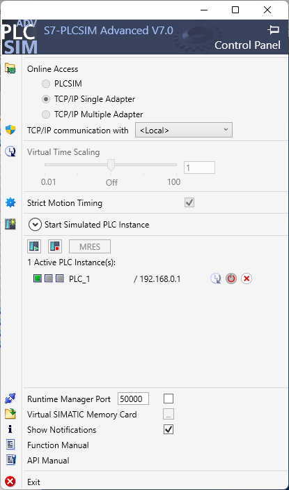

# FC_Escalado

> Escalado lineal genérico de un valor analógico crudo (0-27648) a un REAL en unidades de ingeniería; fuente SCL verificada en V20, con descarga a CPU virtual y nueve casos de escalado observados en PLCSIM.

**Tipo:** `Función (FC)`
**Versión TIA Portal:** V20 *(compatible con V18 y V19)*
**Familia PLC:** S7-1200 / S7-1500

**Fuente:** [`FC_Escalado.scl`](FC_Escalado.scl) · **XML exportado:** [`FC_Escalado.xml`](FC_Escalado.xml)

---

## Estado comprobado

- **Fuente disponible:** el archivo SCL se incluye aquí, y el `.xml` exportado del bloque.
- **Compilación:** importada como fuente externa en un proyecto desechable con CPU S7-1500
  `6ES7513-1AM03-0AB0` y compilada en TIA Portal V20 el 21/10/2026 con **0 errores y 0
  advertencias**. El readback del bloque da `FC_Escalado [FC1, SCL]`, `isFailsafe=false`,
  `isKnowHowProtected=false`, `isConsistent=true`.
- **Ejecución en PLCSIM:** descarga `Success` con 0 errores y 0 avisos a una CPU 1513 virtual
  (PLCSIM Advanced V7.0, modo TCP/IP), `GoOnline` → `Online`, y un plan de **33 pasos que pasó
  33/33** con los nueve casos de escalado correctos.
  [Evidencia estructurada](evidencia-plcsim-2026-10-21.json).
- **Arnés:** OB1 en SCL que llama al bloque cada ciclo, con la tabla de tags `Agent_Escalado`.
  El SCL exacto que se ejecutó está en [OB1_Arnes-ejecutado.scl](OB1_Arnes-ejecutado.scl) y el
  detalle en [arnes-ob1.md](arnes-ob1.md).

---

## ¿Qué problema resuelve?

Cuando trabajas con entradas analógicas en formato 0-27648, hay que convertir ese valor crudo a la
unidad de ingeniería real (°C, bar, m³/h…). Cada vez se reescribe la misma fórmula y se acaba
metiendo errores de signos, división por cero o conversión INT/REAL.

`FC_Escalado` hace esa conversión de forma parametrizable, segura y documentada — sin memoria
interna, así que se puede llamar tantas veces como haga falta sin DB de instancia.

Es el **caso de uso más universal** de TIA Portal y la primera pieza que cualquier proyecto
necesita.

---

## Variables / Interfaz

### Entradas (Input)

| Variable | Tipo | Descripción |
|---|---|---|
| `iValorCrudo` | `Int` | Valor crudo de la entrada analógica |
| `iRawMin` | `Int` | Valor raw correspondiente al mínimo de escala (0 para 0-10V, 5530 para 4-20mA) |
| `iRawMax` | `Int` | Valor raw correspondiente al máximo de escala (típico 27648) |
| `rEscalaMin` | `Real` | Valor en ingeniería correspondiente al raw mínimo |
| `rEscalaMax` | `Real` | Valor en ingeniería correspondiente al raw máximo |

### Salida (Output)

| Variable | Tipo | Descripción |
|---|---|---|
| `rEscalado` | `Real` | Valor escalado en unidades de ingeniería |

> **Por qué una salida y no un valor de retorno:** el generador de fuentes SCL de TIA Portal V20
> exige el tipo de retorno en la cabecera (`FUNCTION "FC_Escalado" : Void`) y **rechaza**
> `VERSION`, `AUTHOR` y `FAMILY` en un `FUNCTION`. La forma que genera y compila es la de este
> bloque: salida explícita por `VAR_OUTPUT`. La ficha original de este recurso proponía un
> retorno `Ret_Val`; la implementación real difiere en ese detalle y coincide en todo lo demás.

---

## Lógica interna

```scl
IF #iRawMax = #iRawMin THEN
   #rEscalado := #rEscalaMin;
ELSE
   #rEscalado := #rEscalaMin
              + ((INT_TO_REAL(#iValorCrudo) - INT_TO_REAL(#iRawMin))
                 / (INT_TO_REAL(#iRawMax) - INT_TO_REAL(#iRawMin)))
              * (#rEscalaMax - #rEscalaMin);
END_IF;
```

Dos decisiones que no son obvias:

- **La resta se hace en `REAL`, no en `INT`.** Con el rango completo de `INT` (-32768..32767),
  restar en `INT` puede desbordar y devolver un valor sin sentido. Restando en `REAL` el
  resultado es correcto en todo el rango.
- **La división por cero se cubre antes de dividir.** Si `iRawMax = iRawMin` no hay escala
  posible; se devuelve `rEscalaMin` en vez de dejar que el ciclo reviente.

---

## Cómo importarlo en TIA Portal

1. Descarga el archivo [`FC_Escalado.xml`](FC_Escalado.xml).
2. En TIA Portal, abre tu proyecto.
3. En el árbol del proyecto, clic derecho sobre **Bloques de programa** → **Importar** → confirma.
4. O, desde un fuente SCL: importa [`FC_Escalado.scl`](FC_Escalado.scl) como fuente externa y
   genera los bloques desde ella.

---

## Ejemplo de uso

```scl
// Sensor de pH (0-10V) escalado a 0.0-14.0 pH
"DB_Proceso".rPH_Reactor := "FC_Escalado"(iValorCrudo := %IW64,
                                           iRawMin     := 0,
                                           iRawMax     := 27648,
                                           rEscalaMin  := 0.0,
                                           rEscalaMax  := 14.0,
                                           rEscalado   => "DB_Proceso".rPH_Reactor);
```

---

## Notas / Limitaciones conocidas

- El bloque hace una conversión **lineal**. Para sensores no lineales (termopares en mV crudos
  sin linealizar), usa los bloques `SCALE`/`SCALE_X` de Siemens o aplica una linealización a
  tramos antes.
- Si `iRawMax = iRawMin` el bloque devuelve `rEscalaMin` para evitar división por cero (no salta
  excepción).
- El bloque **no satura** la salida: si el raw está fuera del rango configurado, devuelve un
  valor escalado fuera de `rEscalaMin` / `rEscalaMax`. Si necesitas saturación, envuélvelo con
  `MIN`/`MAX` en el sitio de llamada. **Verificado:** con raw 30000 sobre 0-27648 la salida fue
  108.507, no 100.
- Para módulos de alta resolución (-32768 a 32767), pasa esos valores como `iRawMin`/`iRawMax`.
- La resta en `REAL` evita el desbordamiento de `INT`, pero `iValorCrudo` sigue siendo un `Int`:
  el rango del raw es el del `INT`.

---

## Prueba ejecutada

Arnés: [`arnes-ob1.md`](arnes-ob1.md) · OB1 ejecutado: [`OB1_Arnes-ejecutado.scl`](OB1_Arnes-ejecutado.scl)

| Caso | Forzado | Esperado | Observado |
|---|---|---|---|
| escala-mínimo | `0..27648 → 0..100`, raw 0 | 0 | **0** |
| escala-máximo | raw 27648 | 100 | **100** |
| escala-mitad | raw 13824 | 50 | **50** |
| escala-cuarto | raw 6912 | 25 | **25** |
| 4-20 mA mínimo | `5530..27648 → 0..10`, raw 5530 | 0 | **0** |
| 4-20 mA media | raw 16589 | 5 | **5** |
| fuera de rango | raw 30000 | 108.5069 | **108.507** |
| raw negativo | raw -1000 | -3.6169 | **-3.6169** |
| rango degenerado | `RawMin = RawMax = 1000` | 7.5 | **7.5** |

Plan completo: 33 pasos, 33 correctos. La diferencia entre 108.5069 esperado y 108.507 observado
es la precisión de 6 dígitos con la que el adaptador de PLCSIM serializa los `REAL`, no un error
de cálculo.



*Captura directa del Control Panel de PLCSIM Advanced V7.0, 21/10/2026: `1 Active PLC
Instance(s): PLC_1` en marcha y `/ 192.168.0.1`.*

---

## Autor

**GitHub:** [@iagorobo24-hub](https://github.com/iagorobo24-hub)
